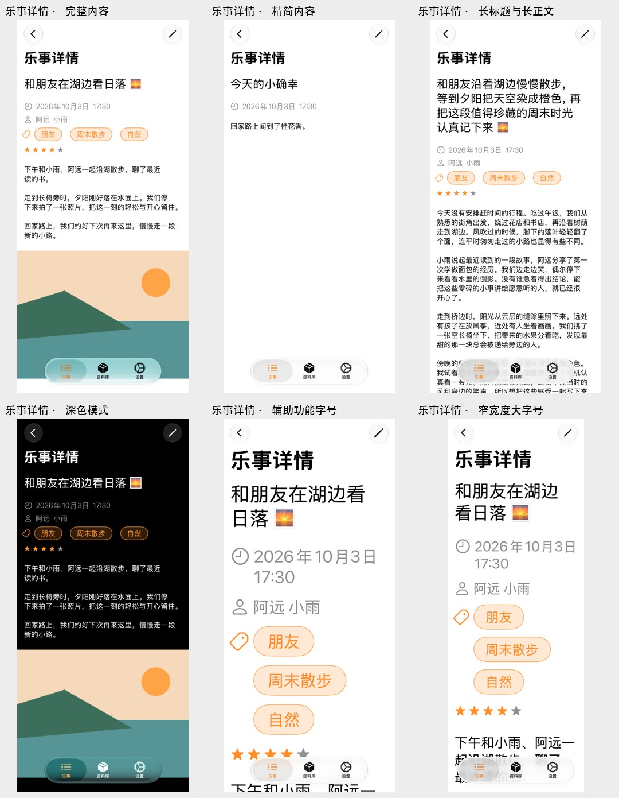
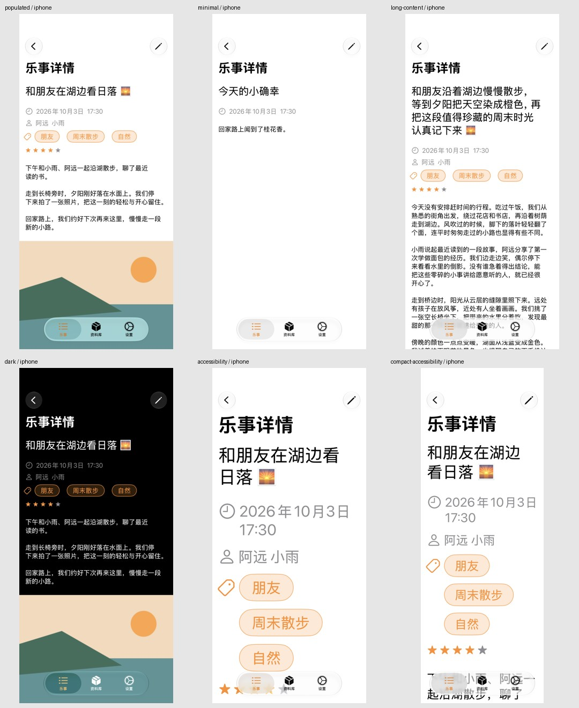
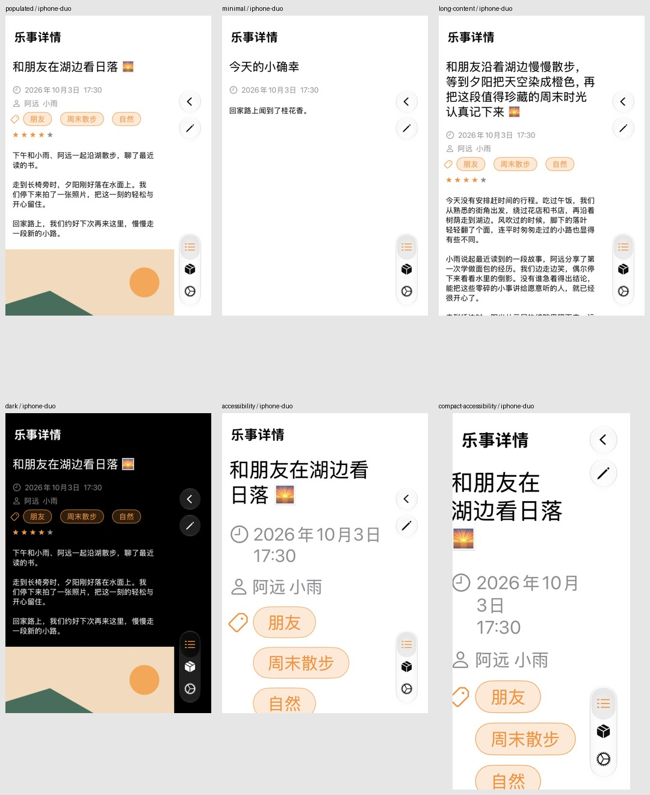

# Issue #60：乐事详情 Preview 验证

2026-10-13 验证：六个场景均由 Xcode `RenderPreview` 成功渲染，返回 `errors: []`。已逐张检查首屏；下方截图保留完整视口，不是滚动长图。交互项尚未完成验证。

## 实现与静态检查

Canvas 入口位于 `HDiary/Preview Content/MomentDetailPreviews.swift`，以 App target 加载正式本地化和 AccentColor。宿主和场景数据位于 `HDiaryLibrary/Sources/HDiaryAppFeature/Moments/MomentDetail/Preview/`，通过正式乐事列表的路由展示 `MomentDetailView`，共用 `HDiaryTabShell`。

每个场景创建独立 SwiftData 内存容器，关闭 CloudKit 和云状态同步。日期固定为 2026-10-03 17:30（UTC+8），使用固定虚构文本和本地生成的 PNG；访问计数及编辑只作用于场景内的数据。正式详情页的布局和业务代码未改动。

已执行项目生成和 `git diff --check`。五个新增 Swift 文件（含 snapshot 测试）通过 SwiftLint 严格规则检查：本机为 0.63.3，使用临时配置仅移除仓库声明的 0.58.0 版本一致性检查，未修改仓库的 `.swiftlint.yml`。共享 `ListSnapshotFixtures.swift` 的原有 `prefer_self_in_static_references` 违规位于未修改的第 9 行；新增的 fixture 属性和初始化沿用现有结构。已运行下述独立截图计划，未运行其范围以外的完整业务测试或远端 CI。

## Snapshot 回归

新增 `HDiarySnapshotTests/MomentDetailSnapshotTests.swift`，使用 Swift Testing 的六个参数化场景，直接渲染与 Canvas 共用的 `MomentDetailPreview` 和内存 fixture。现有 `HDiarySnapshots` 计划已选择整个截图 target，新测试会自动进入现有 CI；无需另外维护测试清单。新增 12 张基准，原有 52 张基准未修改。

| 设备 | 完整截图回归 | 计划内数据／头像用例 | 新 suite 单独运行 |
| --- | --- | --- | --- |
| iPhone 17 Pro / iOS 27.0 | 32/32 通过 | 24/24 通过 | 6/6 通过 |
| iPhone Duo / iOS 27.1，Closed 竖屏 | 32/32 通过 | 24/24 通过 | 6/6 通过 |

以上均为关闭录制后的比较结果。XcodeBuildMCP 按测试函数统计为每设备 28 个函数通过；表中按参数展开后的用例计数。测试使用同一份构建产物，先跑完整计划，再单独运行新 suite，确认两种运行方式都通过。日志和结果包索引保存在 [snapshot-validation.json](snapshot-validation.json)。

最初的完整内容示例只有两段正文，图片底边恰好穿过 iPhone 的玻璃 Tab 栏。该区域在单独运行与整套运行中出现可重复的颜色差异，其他内容和布局一致。最终示例增加固定的第三段虚构正文，将这条边界移出工具栏区域；仅更新本次新增的基准，并验证上述两种运行方式。测试仍直接使用现有图片断言，没有加入预热、延迟、重试、区域遮罩或放宽阈值，沿用 `precision: 1, perceptualPrecision: 0.94`。

**已知布局问题：** Duo 的 320 pt / `accessibility2` 基准中，标题、日期图标等内容的左缘存在裁切。截图记录并监测当前呈现，正式详情布局仍按 issue 范围保持原样。这与首屏底部正常的滚动视口截断不同。交互及滚动到最后图片的验证边界见下文。

## 场景与结果

| 场景 | 固定视口 | 原始截图像素 | 首屏检查 |
| --- | --- | --- | --- |
| [完整内容](00-full.png) | 402 × 874 pt | 689 × 1500 | 中文标题、时间、人物、标签、评分、正文和图片可见；返回、编辑与 Tab 栏可见。 |
| [精简内容](01-minimal.png) | 402 × 874 pt | 689 × 1500 | 标题、时间和短正文可见；缺少人物、标签、评分及图片时无空占位。 |
| [长标题与长正文](02-long.png) | 402 × 874 pt | 689 × 1500 | 长标题自然换行，首屏正文无横向截断；后续正文及图片在视口外。 |
| [深色模式](03-dark.png) | 402 × 874 pt | 689 × 1500 | 黑色背景、白色正文、橙色强调色和图片正常显示。 |
| [辅助功能字号](04-accessibility.png) | 402 × 874 pt | 689 × 1500 | `accessibility3`；标题和时间换行，标签分行，无首屏文字重叠或横向截断。 |
| [窄宽度大字号](05-narrow-accessibility.png) | 320 × 874 pt | 549 × 1500 | `accessibility2`；窄视口中的标题、时间、人物和标签正常换行。 |

长内容及大字号首屏中，内容延伸到浮动 Tab 栏后方，底部被视口截断。这些截图仅证明首屏布局，不能据此证明末尾内容可滚动到达；尚未将正常的滚动视口边界判定为布局缺陷。

## 实际渲染环境

- Xcode 工程：`HDiary.xcodeproj`，scheme：`HDiary`。
- 共享配置和 Xcode 当前运行目标：`HDiary Snapshot iPhone 17 Pro`，iOS 27.0，UUID `040ECFE5-4ED3-4795-AC27-23490CF57596`。
- **六个场景的 RenderPreview 实际返回的渲染目标均为 iPhone Duo / iOS 27.1**，identifier `6344CAB1-C054-4343-A321-A24B045F1DA7`。完整内容与深色场景在补充第三段正文后重新渲染并更新了图片。这部分 Canvas 证据不是配置的 iPhone 17 Pro 设备验证；两种设备的 snapshot 结果见上文。
- Preview 使用固定宽高的 Canvas 视口，截图导出尺寸与点数不同；没有为截图拉长视口或拼接正文。
- 每张 PNG 同名 JSON 保存了 RenderPreview 参数、时间、目标和实际结果；[manifest.json](manifest.json) 汇总可复查信息。

## 交互验证边界

使用 `device-interaction` 技能，通过 Xcode MCP 尝试连接已有 Preview runtime，没有安装或启动真实用户 App，没有修改产品源码或用户数据。

1. 连接 RenderPreview 返回的 `6344…` 设备后，设备截图与 UI hierarchy 只显示 SpringBoard；返回 `applicationState: NotRun`，无法看到 Canvas 场景。
2. 检查本地进程确认，Preview 中的 HDiary 运行于 Xcode 私有预览模拟器目录 `Xcode/UserData/Previews/Simulator Devices/5E64F0FC-0012-44F1-A2BA-DF709319E48E`。定向连接该 UUID 时，`DeviceInteractionStartSession` 返回 `Cannot select specified device`。
3. 已调用 `DeviceInteractionEndSession` 清理先前会话，工具确认会话已不存在；第二次连接未创建会话。

因此以下项目均标为**未验证**：返回列表后再次进入详情、重进前后的导航标题样式一致性、点击编辑弹出编辑页、长正文滚动到最后图片、大字号和窄宽度场景滚动到最后图片。此限制属于自动化工具无法选择私有 Preview 运行设备，不能算作交互通过，也不据此认定产品功能失效。

## 在 Xcode 中继续验证

1. 新 checkout 先按仓库说明运行 `./scripts/generate-project.sh`，再打开 `HDiary.xcodeproj`；已生成的当前 checkout 无需重复生成。
2. 选择 `HDiary` scheme，打开 `HDiary/Preview Content/MomentDetailPreviews.swift`，显示 Canvas。
3. 在 Canvas 中依次选择六个命名场景；场景的 SwiftData fixture 仅驻留内存。
4. 使用 Canvas 的交互模式，验证返回列表后重进、编辑弹出，并在长内容、大字号及窄宽度场景中向下滚动至最后图片。
