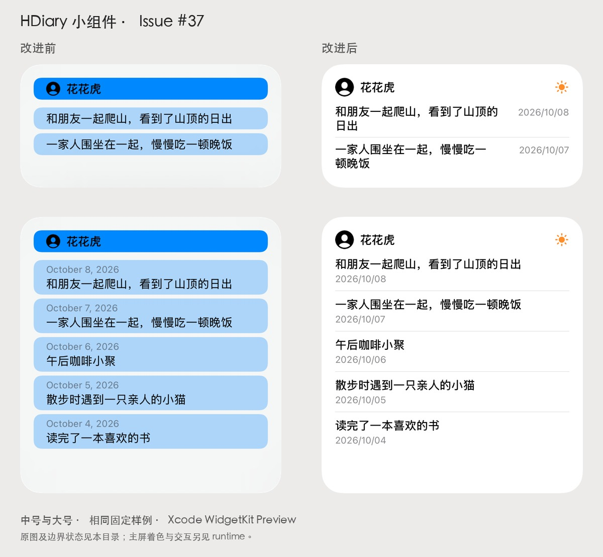

# Issue #37：小组件视觉与布局

## 改动

- 中号、大号均使用轻量标题区、圆形头像和应用的橙色太阳标识，移除逐条内容的彩色底卡。
- 中号把日期放在正文右侧；大号把日期放在正文下方。正文最多两行，长姓名单行省略，所有内容统一左对齐。
- 保留原有最多 8 条候选记录及时间顺序，按实际可用高度选择能完整容纳的条数；较大辅助字体使用上下排列并减少条数。
- 空状态给出明确提示和打开应用记录的引导。文字、背景和分隔线使用系统语义颜色；系统占位头像跟随前景色，照片保持原图并裁成圆形，在系统着色模式中使用 `desaturated`。
- Widget kind、支持尺寸、AppIntent 配置、数据源、timeline 刷新策略和点击打开应用的机制保持原样。

## 前后截图

| 尺寸 | 改进前 | 改进后 |
| --- | --- | --- |
| 中号 | [原图](before/medium.png) | [原图](after/medium.png) |
| 大号 | [原图](before/large.png) | [原图](after/large.png) |

基线来自 `6de74fa` 的原始视图。改进前后均使用同一套固定样例：同一参与者、同一组 5 条记录、固定日期 2026-10-08，避免日期与随机内容影响对比。样例现在集中在 `HDiaryWidget/MomentWidgetPreviewFixtures.swift`，供完整小组件和各组件预览复用。

这些是 **Xcode WidgetKit Preview** 原图，不是主屏截图。虽然工作区选择的是 `hdiary 17pro`，Xcode Preview 实际返回的渲染目标是 iPhone Duo / iOS 27.1。Preview 中原视图的环境 `accentColor` 呈蓝色；这些早期 Preview 截图保留拆分布局时的图标，太阳图标当时的系统呈现见本文下方历史 Widget 系统快照；当前内容和日期格式见新的 Widget 单元截图。Preview 的日期及界面语言以图中实际渲染为准；本次工具传入 `zh-Hans` 后部分系统文字仍显示英文。实际主屏验证另见 [runtime](runtime/README.md)。

## 边界状态

| 场景 | 中号 | 大号 | 观察 |
| --- | --- | --- | --- |
| 长姓名与长正文 | [截图](after/medium-long.png) | [截图](after/large-long.png) | 姓名一行、正文两行省略；中号显示 2 条、大号显示 4 条，无重叠 |
| 单条记录 | [截图](after/medium-single.png) | [截图](after/large-single.png) | 保持统一排版与自然留白 |
| 空状态 | [截图](after/medium-empty.png) | [截图](after/large-empty.png) | 提示和引导可见，无大图标挤占正文空间 |
| 所有人 | [截图](after/medium-all.png) | [截图](after/large-all.png) | 显示通用“乐事”标题，无虚假的参与者头像 |
| 深色 | [截图](after/medium-dark.png) | [截图](after/large-dark.png) | 正文、日期和默认头像均可见 |
| AX 5 长内容 | [截图](after/medium-long-accessibility.png) | [截图](after/large-long-accessibility.png) | 由 WidgetKit 控制字体大小；完整行数随空间减少，无越界 |
| AX 5 空状态 | [截图](after/medium-empty-accessibility.png) | — | 提示与引导均可见 |

截图检查发现并修复了深色下默认 `UIImage` 系统头像显示为黑色的问题；`.isSymbolImage` 使用模板渲染，照片仍用原图渲染。

## 复现

1. 执行 `./scripts/generate-project.sh`，打开 `HDiary.xcodeproj`。
2. 在小组件扩展中的 `MomentWidgetPreviews.swift` 选择 Entry · Medium 或 Entry · Large。预览入口位于真实扩展 target，避免把 Widget Preview 放在 Swift Package 内时 Xcode 报 `No candidates found to host preview`。
3. timeline 的 0–5 项依次为：普通、长内容、单条、空状态、所有人、彩色图片头像。
4. 用 Preview 的 Color Scheme 与 Dynamic Type 控件切换浅色、深色及 AX 5。
5. 着色模式需要在模拟器主屏的“编辑 → 自定”中检查；本次 RenderPreview 提供的变体列表没有着色选项，不能把普通 SwiftUI 环境覆盖当成系统着色证据。

### 独立组件 Preview

在同一文件的 Canvas 中，还可以直接选择以下预览：

| View | Canvas 名称 | timeline 样例 | 渲染截图 |
| --- | --- | --- | --- |
| `MomentWidgetEntryView` | Entry · Medium / Entry · Large | 普通、长内容、单条、空、所有人、彩色图片头像 | [中号](component-previews/entry-medium.png) / [大号](component-previews/entry-large.png) |
| `MomentWidgetHeader` | Header | 普通姓名、长姓名、所有人 | [标题](component-previews/header.png) |
| `MomentWidgetMomentsView` | Moments · Medium / Moments · Large | 普通、长内容、单条 | [中号](component-previews/moments-medium.png) / [大号](component-previews/moments-large.png) |
| `MomentWidgetRow` | Row · Medium / Row · Large | 普通、长内容 | [中号](component-previews/row-medium.png) / [大号](component-previews/row-large.png) |
| `MomentWidgetEmptyView` | Empty · Medium / Empty · Large | 空状态 | [中号](component-previews/empty-medium.png) / [大号](component-previews/empty-large.png) |

`MomentWidgetComponentPreview` 是仅用于 Debug 的 Widget 包装器，不加入正式的 WidgetBundle。它让各组件预览获得真实 WidgetKit 的尺寸和只读 `widgetFamily` 环境值，同时使用扩展内的主题色及本地化资源。浅深色及字号可用 Canvas 控件切换。

2026-10-11：原生 Xcode MCP 构建成功，以上 9 个 Preview 定义的默认 timeline 均实际渲染成功，结果见 [渲染记录](component-previews/results.json)。选定目标仍为 `hdiary 17pro`，Preview 工具实际使用 iPhone Duo / iOS 27.1。此次只补充 Debug 预览与固定样例，3 个预览 Swift 文件通过 SwiftFormat、严格 SwiftLint 和 `git diff --check`，未重复运行业务回归测试。

## Widget 单元截图测试（当前方案）

2026-10-11 根据用户要求，将 `HDiaryWidgetSnapshots` 改为 XCTest 单元测试。直接渲染正式 `MomentWidgetContentView`，移除专用 fixture Widget、App Group 和 SpringBoard UI 自动化。复用已有 SnapshotHost 以加载 `Bundle.main` 资源。固定数据、尺寸、locale 和 traits，通过 SnapshotTesting 逐像素比较。

- 26 张整卡：Medium／Large、fullColor／accented 代码分支、浅深色、两种头像及内容边界；整卡大字号使用 AX1。
- 2 张行组件：Medium／Large 的 AX5 单行降级；不作为主屏 AX5 整卡验收。
- 按用户要求，从当前源码重新构建并录制最新基准；Widget 的 28 张图与上一轮单元截图基准完全一致。关闭录制后，**28 张全部比较通过，3 个方法通过、0 失败／跳过**；方法合计 0.757 秒，含启动总耗时 9.191 秒。
- 测试 target 编译无 error／warning。正式 App／Widget Debug 构建成功，另有 7 条来自未修改的 CloudData／ExportData 源码及宏的 warning。
- 共用宿主的既有列表三项按整组重新录制后，关闭录制连续两次 3／3 通过。最终只有空列表基准出现最多 2 级 RGB 值的玻璃像素变化；展开和分组列表基准与本轮之前一致。测试源码和容差保持不变。
- 列表本来就是单元截图测试；此前展开列表失败、单独录制与整组运行的差异根因尚未确认，不能归因于 Widget 测试迁移。过程和产物见 [基准刷新记录](widget-unit-snapshots/baseline-refresh.json)，刷新前的失败记录仍保留。
- 最新完整复跑：本地默认设备已统一为 iPhone 17 Pro／iOS 27.0（24A434）。`HDiary` 的 120 项 iOS 单元测试、`HDiarySnapshots` 的 26 个截图及 24 个数据／头像用例、Widget 的 28 张截图全部通过；录制关闭，基准和容差均未调整。见 [完整复跑记录](ios27-unit-tests.json)。
- CI 已改为运行单元截图；远端尚未执行。

[运行说明与覆盖边界](../../../HDiaryWidgetSnapshotTests/README.md)、[中号总览](widget-unit-snapshots/medium.png)、[大号总览](widget-unit-snapshots/large.png)、[结果记录](widget-unit-snapshots/results.json)。Tinted／Clear 的最终系统合成仍需 Widget Preview／主屏人工检查，注入 `.accented` 只能覆盖我们的代码分支。

## 历史 Widget 系统快照测试（已移除）

以下描述先前 UI 测试方案及其历史结果，不能作为当前代码和当前单元测试的验证结果。下方 34／34 通过使用的是旧编译产物；随后用户修改日期格式后重新构建，2026-10-11 13:26 的完整复跑为 2 张通过、32 张不同（主要为日期及由日期宽度引起的中号换行变化）。这些系统基准不再参与测试。

当时新增独立 `HDiaryWidgetSnapshots` scheme，在 iPhone 17 Pro / iOS 27.0（24A434）的真实主屏上运行。正式 `MomentWidgetEntryView` 由专用测试 Widget 展示，样例与 Preview 共用；固定日期、UUID、时区、内容和头像，不读取业务数据。

- 中号、大号各 17 张，共 34 张 PNG 基准。
- 外观覆盖 Default、Dark、Tinted Light/Dark、Clear（Glass）Light/Dark，每种分别测试系统头像和彩色图片头像。
- 内容覆盖长姓名与长正文、单条、空状态、所有参与者和 AX5 字号。
- SnapshotTesting 1.19.6 使用严格像素比较；等待 WidgetKit 场景标记更新和连续三帧像素稳定后才截图。
- 浅深色切换会重置系统墙纸亮度。测试在选择最终外观后固定亮壁纸，Tinted 固定为 teal，并断言系统控件状态。

Review 可看 [外观总览](widget-snapshots/appearances.jpg)、[内容总览](widget-snapshots/content.jpg) 和 [基准尺寸及 SHA256](widget-snapshots/baselines.json)。当时 CI 接入 iPhone job；当前已由上方单元截图方案替代。

2026-10-11 旧编译产物比较：**Medium 17／17、Large 17／17，共 34 张全部通过**。这是分别运行的 2 个 XCTest 方法（0 失败、0 跳过），使用同一份编译产物和同一台专用模拟器；没有启用录制。结果、设备信息与本机 `.xcresult` 路径见 [results.json](widget-snapshots/results.json)，精简运行日志见 [Medium](widget-snapshots/medium-passed.log) 和 [Large](widget-snapshots/large-passed.log)。既有列表快照 smoke 3／3、测试宿主 Release 构建、工程重复生成与相关 Swift 文件 lint 也通过。

期间另一台模拟器曾出现两张 Tinted Light 截图变灰，虽然系统控件仍为 teal／76%。完整中号复跑和原异常设备上的 `photo-tintedLight` 单项复查都通过；没有改动基准、容差或加入自动重试。手动复现未重现，原因仍未确定，后续 CI 的稳定性还需观察。保留 [失败日志](widget-snapshots/tinted-light-transient.log)、[差分图](widget-snapshots/tinted-light-transient.png)（基准／实际／差异）和 [原设备复查日志](widget-snapshots/medium-tintedLight-recheck-passed.log)，不把复跑通过等同于已修复这次系统外观异常。

## 本地检查

- 固定版本 XcodeGen 生成及重复生成不变性验证通过，保留既有 targets、schemes、test plans、StoreKit 和依赖锁，当前检查 Widget unit test target、scheme 和宿主依赖。
- 修改的 7 个 Swift 文件通过 SwiftFormat lint、严格 SwiftLint 和 `git diff --check`。本机 SwiftLint 是 0.63.3，使用仓库规则的临时副本仅移除旧版 0.58.0 的版本提示，未改动仓库规则文件。
- Debug 模拟器构建、安装、启动成功；完整主屏操作证据由 [运行验证报告](runtime/README.md) 记录。
- 原生 Xcode MCP `RunSomeTests` 在 `hdiary 17pro`（iPhone 17 Pro / iOS 26.5 / arm64）运行 15 项既有回归测试，全部通过，0 失败、0 跳过。详见 [逐项测试结果](test-results.json)。
  - `MomentWidgetIntentTests`：8 项，覆盖参与者 UUID、所有人配置、独立快照读取、存储就绪重试和头像映射。
  - `WidgetSnapshotCoordinatorTests`：6 项，覆盖写入完成后 reload、失败时保留快照、合并请求和串行后续更新。
  - `WidgetSnapshotCoordinatorChangeTests`：1 项，验证快照未变化时不触发 reload。

## 验证范围

浅色、深色、长内容、少量内容及空状态由固定样例的 WidgetKit Preview 验证；系统着色、透明模式、两种尺寸展示、参与者配置切换及点击打开应用由指定模拟器的真实主屏验证。配置切换后的内容更新已实测，快照写入及 reload 行为有上述回归测试覆盖。

**新增或编辑日记后到主屏更新的端到端流程尚未实测。** App 内的可访问性层级不可用，后续 Mac 锁屏使原生窗口交互不可用，因此没有为此修改模拟器内的任何日记数据。也未进行真机或远端 CI 验证。这里不把单元测试等同于完整主屏刷新验证。
