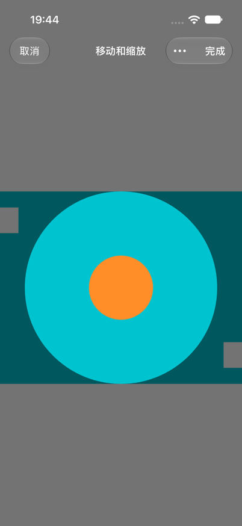
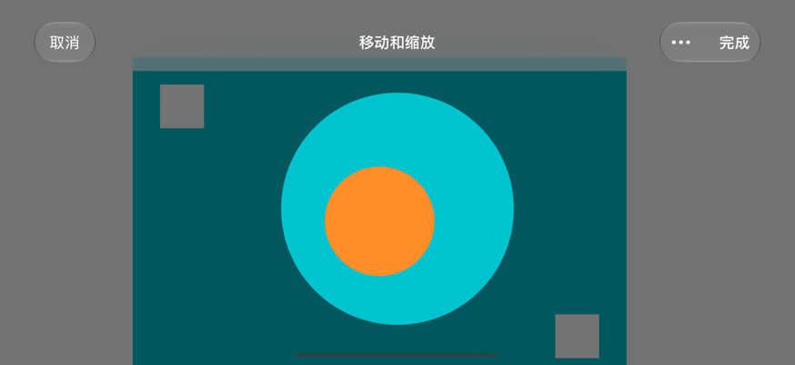

# Issue #40：头像编辑验证

验证日期：2026-10-20。Scheme：`HDiary`；模拟器：iPhone 17 Pro / iOS 27.0。

## 改动

- 新建和编辑人物共用“更换头像”入口，先加载到临时编辑会话，确认并成功编码后才更新人物头像。
- 加载过程可取消；加载或编码失败可重试。取消及旧请求晚到不会覆盖原头像。
- 全屏圆形裁剪，圆外照片压暗显示；使用 `UIScrollView` 统一拖动、双指锚点缩放及边界回弹。
- 提供取消、完成和调整菜单；包含 VoiceOver 缩放、移动及重置操作。圆形选区随安全区域布局，旋转保持选区。
- 加载最长边限制为 2048 像素，导出为 512 × 512 PNG。

## 自动化检查

通过 Xcode 原生 `RunSomeTests` 执行 36 个方法，展开参数后 **56 项通过，0 失败、0 跳过**。见 [逐项测试结果](native-crop-tests.json)。

覆盖 `AvatarEditingSessionTests`、`ParticipantAvatarImageTests`、`ParticipantAvatarLoaderTests`、`ParticipantAvatarPreviewTests`、`HImageCropGeometryTests` 和 `HImageCropCanvasTests`：取消与晚到请求、同图重选的会话状态、失败重试、新建/已有模型保存后重新查询、裁剪边界、8 种图片方向、预览/导出一致及旋转保留选区。

本轮 9 个裁剪相关 Swift 文件 strict SwiftLint 通过，`git diff --check` 通过。SwiftLint 使用本机 0.63.3，仅在临时配置中移除仓库 0.58.0 的版本约束，规则保持不变。既有 `DiaryStringKey.swift` 和 `ParticipantAddEditView.swift` 的 11 项 lint 诊断可在原版复现。

## 模拟器交互

使用 Debug 环境变量 `HDIARY_AVATAR_CROP_VALIDATION=1` 进入真实裁剪控件；验证数据在隔离内存 SwiftData 容器中，禁用 CloudKit。另加 `HDIARY_AVATAR_LARGE_TEXT=1` 验证最大辅助字号。

- 实际验证四向拖动越界、双指最小/最大缩放回弹、偏心缩放，以及调整菜单。
- 横竖屏保持构图；横屏选区与导航栏有约 24pt 间隔。
- 完成后显示的头像与选区一致；取消后原头像 Data 未变。
- 注入一次编码失败后重试，保存成功；此前已验证加载失败重试和加载中取消。
- 最大辅助字号下，菜单缩放、旋转及完成可用；系统导航控件使用其标准呈现字号。

[31.5 秒演示](native-crop-final-demo.mp4)由两个真实会话剪接：前段为缩放与拖动，后段为重新进入后的旋转和保存。每段保留实际动作时间，不代表同一次连续编辑。

| 竖屏 | 横屏 |
| --- | --- |
|  |  |

## 尚未覆盖

- 通过系统照片选择器完成“新建人物/编辑已有头像 → 保存 → 重新进入详情”的整条 UI 链路；同图重选及连续换图目前仅有会话层测试。
- 真机 VoiceOver 朗读、真实 iCloud 下载失败、多设备及全部图片格式。

本地编译、自动化测试、模拟器交互与远端 CI 分别记录；上述结果不代表远端 CI 或真机验收通过。
