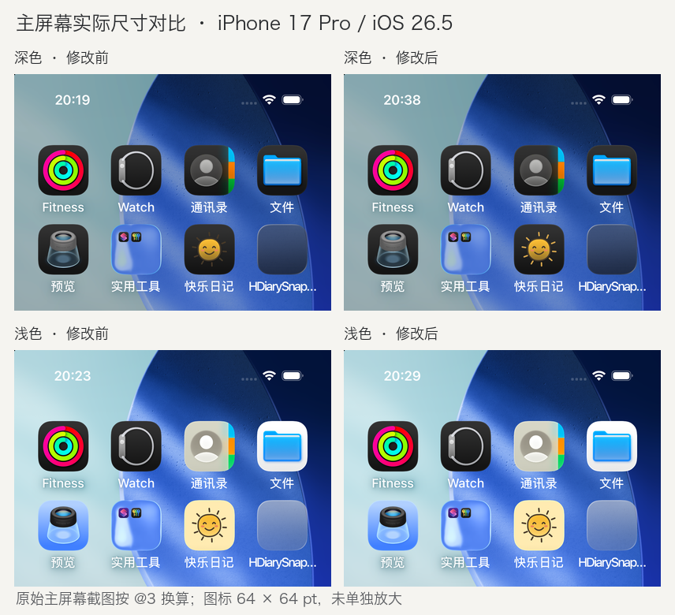

# Issue #50：深色 App 图标光芒

2026-10-11 验证。关联 [issue #50](https://github.com/huahuahu/HHappyDocs/issues/50)。

`HDiary/HDiary-Sun.icon/icon.json` 仅为 `01 光芒` 图层增加 Dark 填充覆盖：暖金色 `#D8A74E`。复用 `01-rays.svg` 的原有路径与线宽；默认外观仍使用 SVG 中的 `#473A29`。太阳、腮红、表情与轮廓、底板和材质设置均未更改。

## 实际主屏幕对照

前后均构建并覆盖安装正式 `HDiary` scheme 的 Debug App，设备为仓库配置的 `hdiary 17pro`（iPhone 17 Pro，iOS 26.5）。保持同一蓝绿壁纸、同一图标位置、小图标尺寸。深色截图选择主屏幕“深色 → 始终”，浅色截图选择默认外观；系统外观保持 Light。没有删除 App 或清理数据。

以下对照取自真实 SpringBoard 截图的顶部区域，统一按 @3 换算为逻辑尺寸，未单独放大图标。原始截图为 1206 × 2622 px；图标位于 `(648, 573, 192, 192)` px，即 **64 × 64 pt**。



| 外观 | 修改前原始截图 | 修改后原始截图 | 观察结果 |
| --- | --- | --- | --- |
| 深色 | [before-dark.png](before-dark.png) | [after-dark.png](after-dark.png) | 原来的深棕光芒接近黑色底板；修改后十根光芒均清楚可辨，太阳主体、眼睛、嘴巴与腮红仍清晰。 |
| 浅色 | [before-default.png](before-default.png) | [after-default.png](after-default.png) | 光芒、配色、表情和整体轮廓视觉一致，没有可见退化。 |

## 构建与资源核对

- 修改前后均运行 `./scripts/generate-project.sh`，并通过 XcodeBuildMCP `build_run_sim` 构建、安装与启动。修改后构建结果为 `SUCCEEDED`，耗时 121.719 秒。
- 四份 SVG 与基线提交完全一致；生产资源仅增加 Dark 的 `fill-specializations`。基线提交和机器可读结果见 [validation.json](validation.json)。
- 使用 Xcode 27.1 RC 随附的 Icon Composer `ictool`，分别以设计代际 26、27 导出 Default / Dark 的 64 pt、@3 图标。两代 Default 前后均为 **0 个变化像素**；Dark 的变化位于光芒，太阳中央区域为 0 个变化像素。
- 主屏幕截图包含系统动态材质，浅色前后截图不声明逐像素相同；上面的逐像素结论仅针对固定参数的 `ictool` 导出。
- `git diff --check` 通过。这次只修改图标资源，未新增或运行业务逻辑测试。

固定参数的导出命令如下，将 `before.icon` 换为修改前资源副本，分别替换 `Default` / `Dark` 和 `26` / `27` 后对照：

```sh
"$(xcode-select -p)/../Applications/Icon Composer.app/Contents/Executables/ictool" \
  before.icon --export-image --output-file before.png \
  --platform iOS --rendition Default --width 64 --height 64 --scale 3 \
  --design-generation 26
```

原生 Xcode 设备交互接口拒绝 iOS 26.5，因此使用 XcodeBuildMCP 构建和操作配置模拟器。其截图接口返回缩小的 JPEG，原始 PNG 由 `simctl io screenshot` 补充获取。本轮没有真机验证；iOS 27 的结论仅来自 Icon Composer 导出，不代表 iOS 27 主屏幕交互验收。

外观覆盖依据 Apple 的 [Creating your app icon using Icon Composer](https://developer.apple.com/documentation/xcode/creating-your-app-icon-using-icon-composer) 中 “Customize variants of your app icon” 说明。
