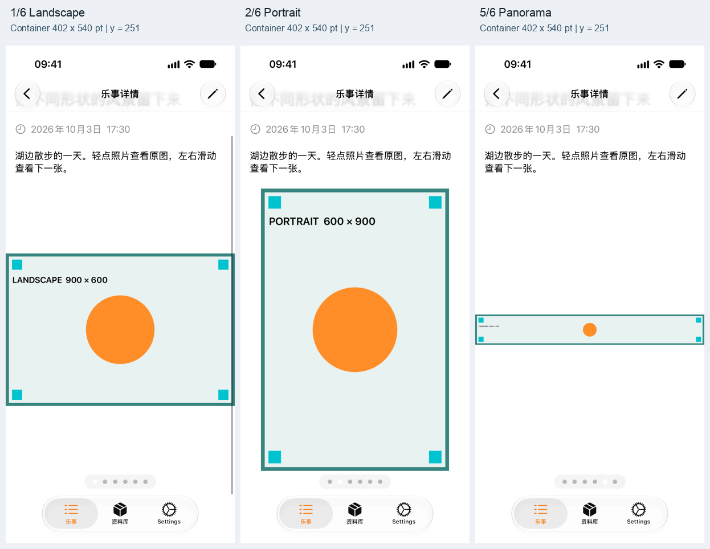
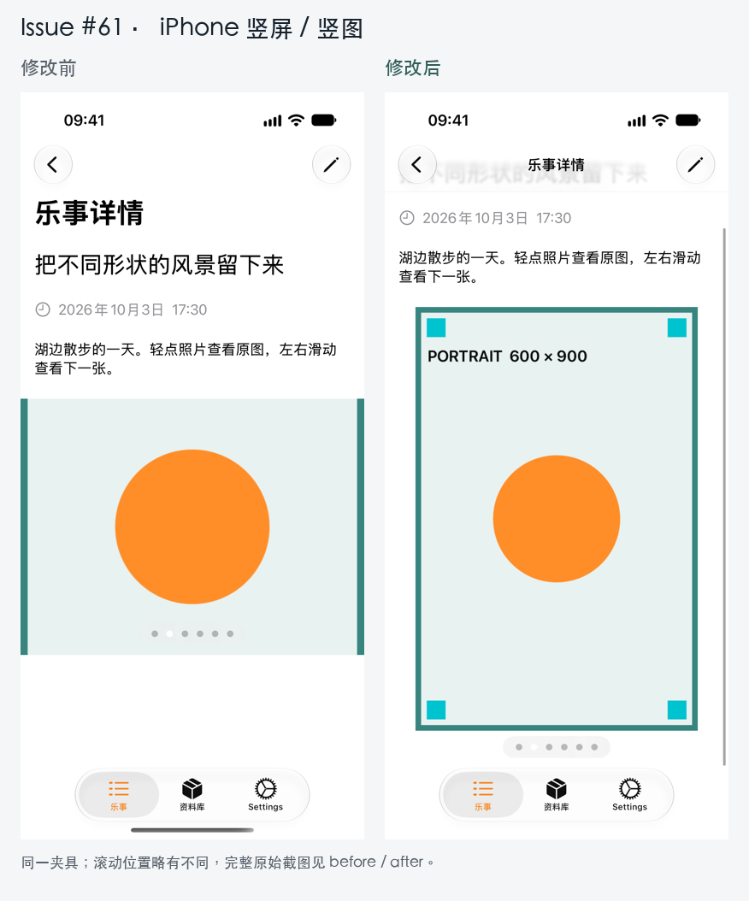
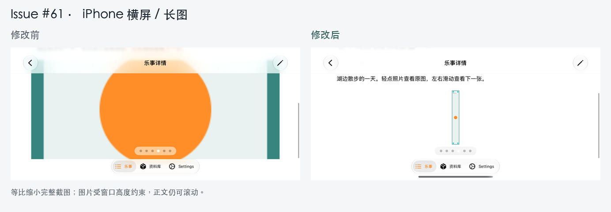
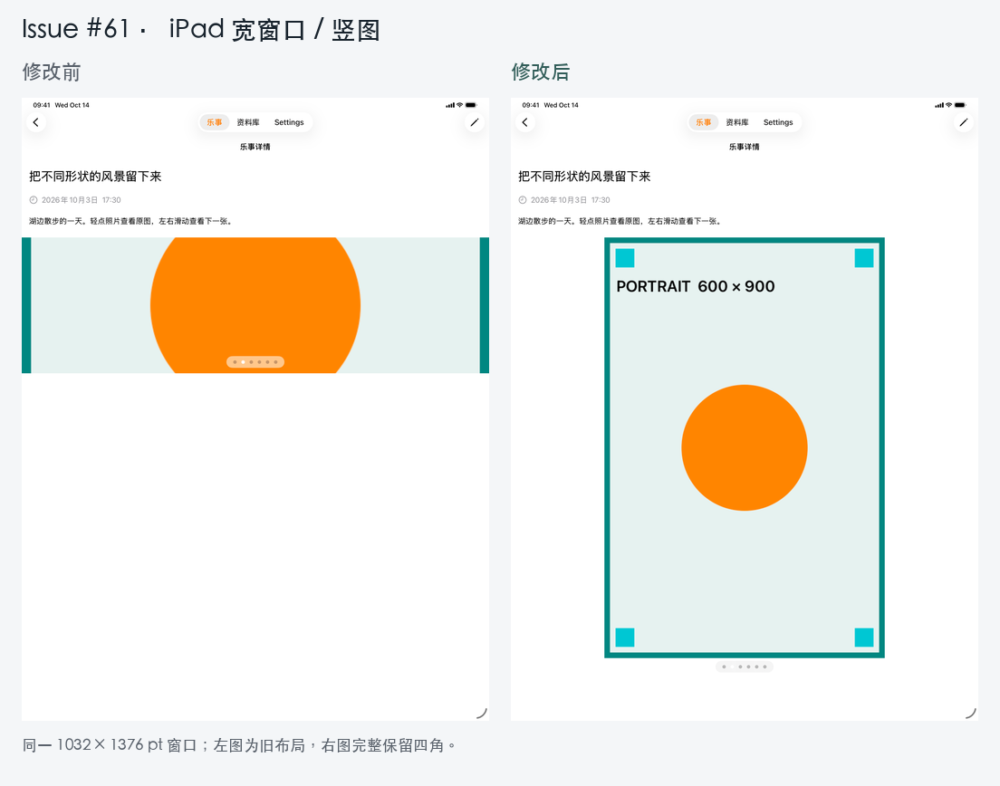

# Issue #61：详情图片预览验证

对应 [issue #61](https://github.com/huahuahu/HHappyDocs/issues/61)。初版验证：2026-10-14；最终多图固定容器复测：2026-10-17。

## 最终行为

- 用 ScrollView 外层的 GeometryReader 直接提供实际可用宽高，并明确约束内容宽度，取消固定的 300 pt 最小高度。
- 单图按缩略图的实际比例计算高度；多图取整组图片按当前宽度计算的最大自然高度，同组翻页保持容器宽高不变。
- 预览总高度不超过当前视口的 80%，其中包含多图的 44 pt 页码预留。全景图至少保留 80 pt 交互区域，仍受总高度上限约束。
- 图片按 fit 完整显示，留白也可以轻点打开原图。保留分页、页码、GIF 标识及 Quick Look；Quick Look 状态和呈现入口由分页容器持有。
- 旋转或窗口尺寸变化后重新计算尺寸；页面仍可纵向滚动。

## 固定容器运行复测

使用独立内存数据和正式详情路由，Debug 启动环境变量为 `HDIARY_MEDIA_PREVIEW=mixed`。六页依次为横图、竖图、方图、长图、全景图、双帧 GIF。PNG 含边框、四角标记和圆形，用于检查裁切和拉伸。

| 环境 | 检查页 | 分页容器 | 图片交互区域 |
| --- | --- | --- | --- |
| iPhone 17 Pro / iOS 27.0 竖屏 | 1–6 | 402 × 540 pt | 402 × 496 pt |
| 同一 iPhone 横屏 | 4、5 | 750 × 208 pt | 750 × 164 pt |
| iPad Pro 13-inch (M5) / iOS 26.5 宽窗口 | 1–5 | 1032 × 973 pt | 1032 × 929 pt |

同一视口和滚动位置下，各页容器、页码及正文坐标一致；测量数据见 [frame-measurements.json](after/fixed-container/frame-measurements.json)。导航栏随纵向滚动收起时可用视口会增高，容器相应重算，这与翻页无关。

- 横屏：[长图](after/fixed-container/landscape-fixed-page-4.png)、[全景图](after/fixed-container/landscape-fixed-page-5.png)。
- 宽窗口：[横图](after/fixed-container/ipad-page-1.png)、[竖图](after/fixed-container/ipad-page-2.png)、[全景图](after/fixed-container/ipad-page-5.png)。
- 取消横滑仍保留原页；旋转后继续翻页正常；纵向滚动能看到媒体底部及页码。
- 冷启动后直接前往第六页，首次打开 GIF 的 Quick Look 持续保持到主动关闭，采集到 [SQUARE 帧](after/fixed-container/gif-frame-sample-0.png)和 [MIXED 帧](after/fixed-container/gif-frame-sample-1.png)。关闭后仍在第六页；第五页可打开对应 PANORAMA 原图。

GIF 的第二帧把方图编码到横向画布，仅用于验证动画及预览生命周期；图片比例检查使用五张独立 PNG。

## 修改前后截图

下面三张对比记录初版从填充裁切改为完整显示的效果。初版仍按当前页调整高度，最终翻页行为以上方固定容器证据为准；手机对比的滚动位置略有不同。

## 自动验证

- 2026-10-14 初版：Debug 构建成功，iPhone 17 Pro / iOS 27.0 与 iPhone Duo / iOS 27.1 的整个 `HDiarySnapshotTests` 各 38 个场景通过。
- 2026-10-17 最终固定容器：Debug 构建成功，两台 iPhone 的六项媒体场景各 6/6 通过，原始结果见 [iPhone](after/fixed-container/snapshots/iphone-final.json)、[Duo](after/fixed-container/snapshots/duo-final.json)。该轮未重复其他 32 个场景。
- 共新增 12 张媒体快照基准；原有详情页基准更新 7 张，反映完整显示及窄窗口裁切改善。固定容器调整仅再更新两张 mixed 基准。快照比较阈值不变。
- 2026-10-18 PR 准备：工程重复生成、依赖锁和项目引用校验通过，`git diff --check` 通过。

### PR 检查发现与修复（2026-10-18）

首轮 CI 中，iPhone 完整快照、Widget 快照及 App Debug / Release 构建和测试通过。Duo 日志报告标签深色和详情窄屏大字号两处不匹配；本地完整回放同样复现了窄屏内容向左溢出。仅通过 `onGeometryChange` 读取尺寸没有限制内容的实际布局宽度。

改为外层 GeometryReader 直接提供尺寸，并将内容宽度约束到当前视口。审核确认 Duo 窄屏的标题、日期及标签在可用区域内换行，左缘文字和图标完整；两台设备的大字号详情场景仅参与者图标的细小尺寸变化。该修复共更新三张受影响的详情基准，未改比较阈值或标签基准。iPhone 图标差异区域为 `(62, 1420)–(166, 1530)`，区域外像素完全一致。

早先按方法调用 `RunSomeTests` 返回的 9 项通过，实际只执行了 3 个 XCTest 和 6 个参数场景，不能证明完整的 38 个快照场景通过。此前对此覆盖范围的记录有误，已用下述完整计划结果替换。

最终使用原生 Xcode `RunAllTests` 执行 `HDiarySnapshotHost` 的完整 `HDiarySnapshots` 计划：iPhone 17 Pro / iOS 27.0 与 iPhone Duo / iOS 27.1 各 62 项通过、0 失败、0 跳过。通过 `xcresulttool get test-results tests` 展开结果树，分别核实 **38 个快照场景和 24 个相关功能/夹具测试**；参数化测试按 `Arguments` 节点逐项计数。原生汇总另列 26 项未执行，这是该计划通过 `selectedTests` 原本排除的 AppFeature 测试。结果及逐项明细见 [iPhone](pr-review/iphone-final.json)、[Duo](pr-review/duo-final.json)。标签深色基准未修改，完整回放通过；此前失败的差异集中在少数边缘像素。

初版 iPhone 的 populated 快照曾出现 Tab 栏下缘阴影细微差异。两次完整回放实际像素一致，审核后仅更新该张因布局变化本就需要更新的基准，完整回放通过；未放宽比较阈值。

快照只比较首屏；分页、取消手势、旋转、GIF 动画和 Quick Look 由上述模拟器交互验证覆盖。未做真机或 Stage Manager 连续拖动缩放。远端 CI 结果以 PR 的检查记录为准。

## 已知独立问题

历史样例中的部分 SF Symbol 转 HEIC 图片在 Apple 解码路径下空白，已独立定位到灰度与 alpha 编码组合。该问题不由布局或缩略图缩放引起，本 PR 没有修改样例编码或既有数据库。比例测试使用可正常解码的本地 PNG/GIF。
